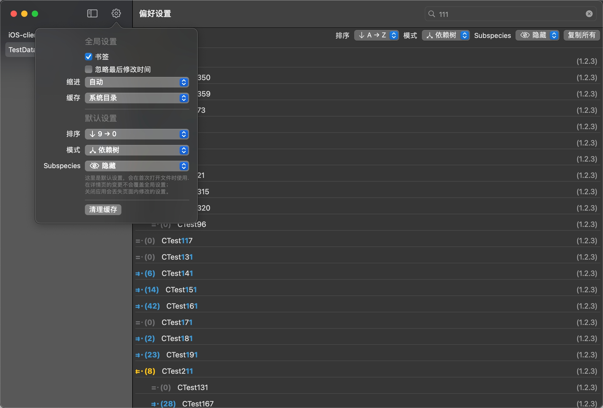

# Aquarius

[](https://github.com/CrazyFanFan/Aquarius/actions/workflows/xcodebuild.yml)

[English](https://github.com/CrazyFanFan/Aquarius/blob/master/README.md)

一个通过分析"Podfile.lock"获取各个库之间的依赖关系的工具。

## 机器翻译

> :warning: **英文版的 README 和应用中的英文都是机器翻译的结果，如有错误请斧正。**

支持以下操作：

- “依赖树”分析；
- “反向依赖树”分析；
- 搜索
- 复制

## 环境

- Xcode: 版本 ≥ 26.3
- macOS: 版本 ≥ 14.0

## 预览



## 使用

- 克隆这个仓库
- 打开 **Aquarius.xcodeproj**
- 等待“Swift Packages”处理完， 按下`Command` + `R`即可。

```shell
git clone https://github.com/CrazyFanFan/Aquarius.git
cd Aquarius
open Aquarius.xcodeproj
```

## 修改日志

### [2026-06-20]

- **功能**
  - 增加 Podspec 访问引导和语法高亮
  - 优化关联查询视图布局、本地化和路径加载
- **优化**
  - 优化依赖树渲染、搜索、路径查找和复制性能
  - 降低递归复制依赖树时的内存占用
  - 现代化 SwiftUI 导航和启动数据流
  - 提升 CoreData 到 SwiftData 迁移的安全性
  - 打开或拖入不支持的文件时展示错误提示
  - 使用轻量复制成功提示并自动隐藏
  - 将“影响树”调整为更通用的“反向依赖树”
  - 更新 Xcode 版本要求到 26.3
  - 更新 Xcode 工程分组结构
- **修复**
  - 修复 Yams 更新和异步任务竞争问题
  - 延后启动状态更新，避免初始状态冲突
  - 命令行打开文件时复用主窗口并自动选中对应的 Podfile.lock
  - 修复模糊匹配行为
  - 更新英文文案并修复拼写问题
  - 取消复制时正确展示取消错误

### [2025-03-26]

- **功能**
  - 支持多栏列表布局
  - 支持查找两个Pod之间的依赖路径
- **优化**
  - 优化了完整依赖树的复制操作

### [2022-11-18]

- **功能**
  - 搜索支持简单的模糊匹配和高亮。
- 其他
  - 修改了少量文本颜色。

### [2020-11-30]

- 支持自定义排序.
- 使用 CoreData 存储书签.
- 支持打开多文件.
- 支持将文件拖动到图标上打开.
- 一些UI细节改动.


## 作者

Crazy凡, [ccrazyfan@gmail.com](mailto:ccrazyfan@gmail.com)

## License

[LICENSE](https://github.com/CrazyFanFan/Aquarius/blob/master/LICENSE)

附加条款:
- **本软件不得用于商业用途。** 商业目的包括但不限于销售本软件的副本，使用本软件提供有偿服务，或将本软件包含在拟出售的产品或服务中。
- **本软件不得通过任何应用程序商店或其他商业分发渠道分发。**
